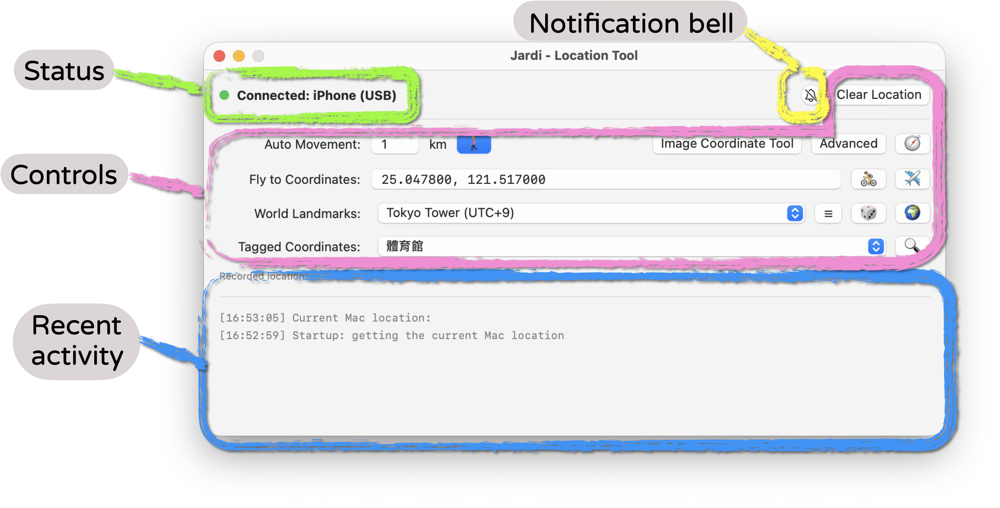

# Interface overview

Jardi has four main areas: connection status, controls, recent activity, and the notification bell.

- **[Status](#status)** shows the iPhone connection and route progress.
- **[Controls](#controls)** let you set a location or start simulated movement.
- **[Recent activity](#recent-activity)** shows recent actions and their results.
- **[Notification bell](#notification-bell)** controls alerts and their settings.

## Status

Before starting, check that your iPhone is connected and ready. During movement, check route progress here. Resolve connection errors before restarting; see [FAQ](FAQ.md). For your first connection, follow [Installation](Install.md).

## Controls

- Jump to a destination with [Virtual location](UserGuide_1.md), using coordinates, world landmarks, or saved places.
- Keep moving with [Virtual movement](UserGuide_1-2.md), using a square spiral or a custom route.
- Build a route from a map with the [Image coordinate tool](UserGuide_2.md).

## Recent activity

Review recent actions and results to check what happened. To keep places or routes for later, use [CSV editing and backups](Data.md); the activity log is not a substitute for saved route files.

## Notification bell

Click the bell to enable alerts. Right-click it to change timing, sound, and notification banners. See [Notifications and the bell](UserGuide_3.md).
