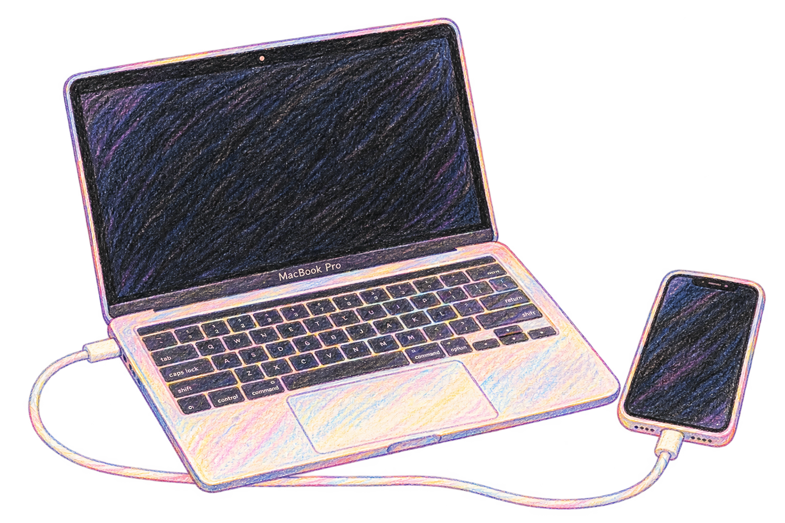

# 下載安裝

用 USB 線連線 iPhone 與 Mac，安裝 Jardi 並啟用。

<!--  -->
<p align="center">
  
</p>

## 下載 Jardi

{{download}}

請以本頁所選版本的發佈資訊為準。正式安裝包不需要另外安裝 Python、pymobiledevice3 或開發工具。

## 使用需求

| 項目 | 需要準備什麼 |
| --- | --- |
| Mac | Apple Silicon（M 系列晶片），macOS 14 或更新版本；目前 DMG 不支援 Intel Mac |
| iPhone | 一次連接一部；iOS 16 起需要開啟開發者模式 |
| USB 線 | 支援資料傳輸，只有充電功能的線材無法使用 |

Mac 帳號需可完成建立連線所需的管理員授權。

<small><small>**相容性說明**：程式保留較舊 iOS 的定位服務，iOS 17 起使用新的連線方式；目前尚未建立經實機驗證的最低 iOS 版本與完整相容清單。</small></small>

## 在 Mac 安裝

1. 下載對應版本的 DMG，按兩下開啟。
2. 將 **Jardi - Location Tool™** 拖進 **Applications（應用程式）**。
3. 退出 DMG，從「應用程式」開啟 Jardi。
4. 如果詢問 Mac 定位權限，允許後，Jardi 會嘗試以 Mac 位置作為初始座標；未允許時也可以手動輸入目的地。

### macOS 阻擋開啟時

若確認安裝包來源可信且未遭更動，可先嘗試開啟 **Jardi - Location Tool™**，接著 **系統設定 → 隱私權與安全性 → 強制打開**，依系統提示確認。

<small><small>目前專案的封裝採用 ad-hoc 簽章，尚未經 Developer ID 簽署或 Apple 公證，因此會遭阻擋。詳見 [Apple：安全地開啟 Mac 上的 App](https://support.apple.com/102445)。</small></small>

## 連接 iPhone

1. 用 USB 線連接 Mac 與 iPhone，並解鎖 iPhone。
    * 如果手機詢問「信任這部電腦」，選擇「信任」。
2. iPhone 開發者模式
    * iOS 16 起，前往 **設定 → 隱私權與安全性 → 開發者模式** 並開啟。
    * 首次啟用需重新開機 iPhone；重啟後解鎖，依提示確認開啟。
3. **Jardi - Location Tool™** 授權
    * 完成 Mac 管理員授權（用於建立與清理手機連線程序，App 不會儲存管理員密碼）。
    * 確認 App 顯示「🟢已連線」，即可使用。

<small><small>找不到開發者模式時，先確認手機已連線並信任 Mac，再參閱 [Apple 開發者模式說明](https://developer.apple.com/documentation/xcode/enabling-developer-mode-on-a-device)。</small></small>


## 試試第一個座標

在「飛經緯度」輸入下列座標。格式是十進位 **`緯度,經度`**，中間使用半形逗號。

```text
25.033968, 121.564468
```

按下飛機「✈️」按鈕，再到 iPhone 的地圖 App （例如 地圖、Google Maps）觀察位置，定位應該會飛到「台北 101」喔！

## 連線卡住了？

依序確認手機解鎖、USB 線可傳輸資料、已信任 Mac、開發者模式已開啟。重新插拔後仍失敗，可用 **⌘Q** 結束 Jardi 再開啟。若提示服務被占用，先關閉其他 iPhone 定位或連線工具。

更完整的處理方式見[常見問題](FAQ.md)。
