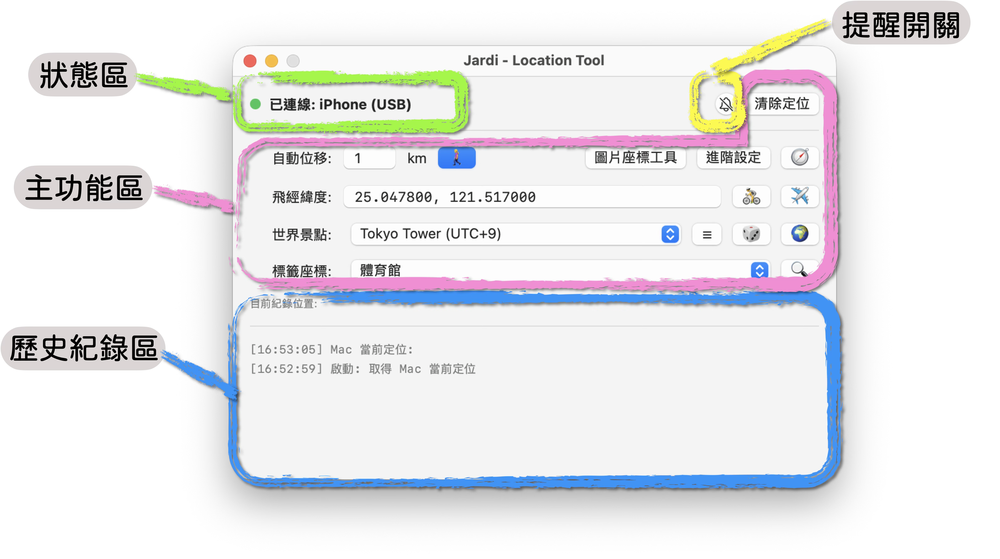

# 介面介紹
開啟 Jardi 後，可以看到四大區塊：狀態區、主功能區、歷史紀錄區、以及提醒開關。

- **[狀態區](#狀態區)**：查看 iPhone 連接狀態與路線進度。
- **[主功能區](#主功能區)**：設定定點定位、自動位移與沿線移動。
- **[歷史紀錄區](#歷史紀錄區)**：查看近期操作紀錄。
- **[提醒開關](#提醒開關)**：開啟小鈴鐺並調整提醒選項。

  

> 選單列可以更換語言，目前支持：繁體中文、英文

## 狀態區

開始操作前，先確認 iPhone 已連線並就緒。移動途中可在此查看路線進度；若出現連線錯誤，先依訊息處理，再重新開始，參考 [常見問題](FAQ.md)。初次連接請見[安裝與設定](Install.md)。

## 主功能區
所有的操作都在主功能區喔～

- 想直接切換位置：使用[虛擬定位](UserGuide_1.md)的飛經緯度、世界景點或標籤座標。
- 想持續移動：使用[虛擬移動](UserGuide_1-2.md)的自動位移或沿線移動。
- 想從圖片建立路線：開啟[圖片座標工具](UserGuide_2.md)，校準並儲存座標。

## 歷史紀錄區

查看近期操作與結果，有助於確認上一次的動作。需要長期保存地點或路線時，請使用 [CSV 編輯與備份](Data.md)，不要只依賴操作紀錄。

## 提醒開關

點擊小鈴鐺開關提醒，按右鍵調整提醒時間、聲音與彈出通知。設定方式見[通知與鈴鐺](UserGuide_3.md)。
