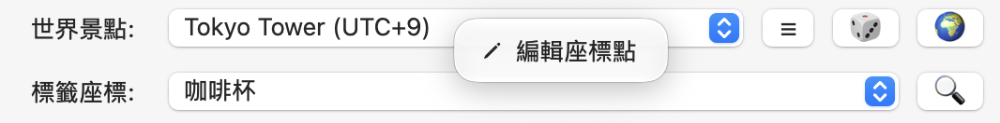

# 虛擬定位

虛擬定位是指切換虛擬定位到特定地點，包含「飛經緯度🚴✈️」、「世界景點🌍」、「標籤座標🔍」，都是飛到定點的功能。
> 注意，當正在使用「自動位移🚶‍♀️」或「沿線移動🧭」時，須先「停止」，方可使用「飛經緯度🚴✈️」、「世界景點🌍」、「標籤座標🔍」、「清除定位」 等飛到定點的功能。

## 飛經緯度 🚴 ✈️

在輸入欄填入 `緯度, 經度`，再按飛往定點。緯度介於 -90 到 90，經度介於 -180 到 180，請使用小數點及半形逗號。

```text
25.033968, 121.564468
```
* 點擊飛機「✈️」，模擬定位會瞬移至該地點。
* 點擊腳踏車「🚴」，會依設定速度，從當前模擬定位移往目的地。速度可在 **「進階設定」** 調整。

## 世界景點 🌍、標籤座標 🔍

從 **世界景點** 或 **標籤座標** 選擇地點，點擊「🌍」或 「🔍」 即可立刻飛至該地點。

<font color="red">想新增自己的地點？</font> 在「下拉選單」處 <font color="red">**右鍵**</font> 開啟 「編輯座標點」，即可加入或刪除座標點。

<p align="center">
  
</p>

參閱 [地點、路線與備份](Data.md)了解 CSV 編輯器。

## 清除定位

**「清除定位」** 會嘗試取得 Mac 的目前位置、同步到手機，再釋放模擬定位。

1. 結束路線後按「清除定位」，留意 App 的結果訊息。
2. 若 Mac 定位失敗，App 仍會嘗試釋放模擬定位；依訊息確認是否成功。
3. 到 iPhone 地圖確認位置，再以 **⌘Q** 結束 Jardi。
4. 若手機仍顯示舊位置，重新開啟定位 App；必要時重新啟動 iPhone。

釋放模擬定位不代表 iPhone 一定立刻取得最新 GPS。請以手機實際顯示與 App 結果訊息為準。

> 使用「自動位移🚶‍♀️」或「沿線移動🧭」的「停止」是停止當前移動到的虛擬位置。並不會回到真正的當前位置。使用 「清除定位」才會回到當前位置。